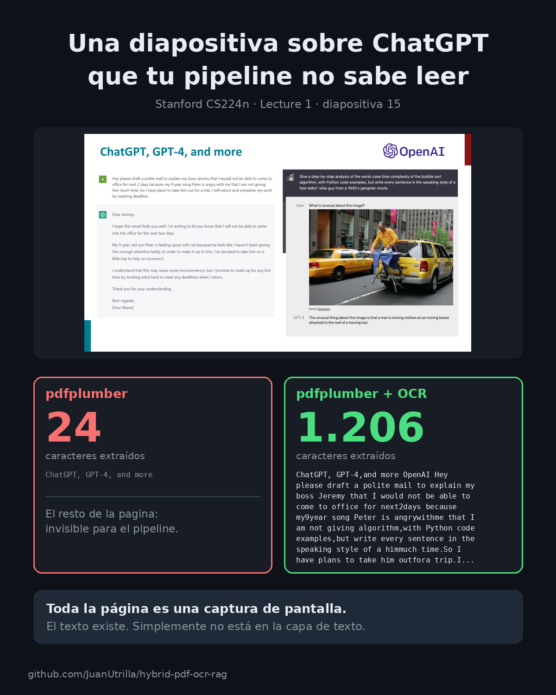
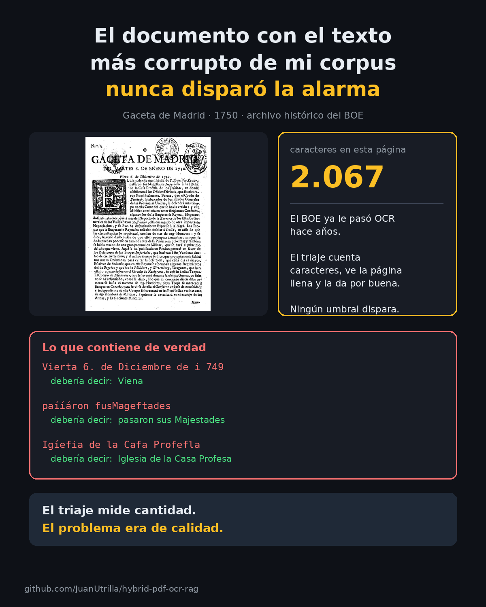

# Cuándo hace falta leer las imágenes de un PDF

Muchos PDF tienen parte del contenido dentro de imágenes: capturas de pantalla, gráficas,
tablas pegadas como foto. Un programa que lee el PDF ve el texto normal, pero lo que hay
dentro de esas imágenes no lo ve. Para leerlo hace falta OCR, que reconoce las letras en
la imagen como lo haría una persona. El problema es que el OCR es lento, y pasarlo por
todas las páginas sale caro.

En este proyecto medí en qué páginas merece la pena usarlo y qué cambia después en un
asistente de IA que responde preguntas sobre esos documentos (lo que se suele llamar un
RAG). Lo probé con 2.382 páginas de 13 documentos públicos.

## Qué páginas pasar por OCR

La costumbre es mirar cuántos caracteres de texto tiene la página y pasarle OCR si tiene
pocos. Yo usé una regla con tres condiciones: poco texto, que la página no esté en blanco
y que tenga al menos una imagen. Encuentra las mismas 26 páginas en las que el OCR aporta
algo que la regla de 1000 caracteres, pasando el OCR 12 veces menos. Con la regla de 10
caracteres, en cambio, 8 de las 11 páginas que van a OCR están en blanco.

Que el OCR sirva o no depende de cómo se fabricó el PDF. En un informe maquetado devuelve
el mismo texto que ya había. En un manual lleno de capturas o en unas diapositivas de
clase recupera texto que de otra forma no existe:



Esa es la diapositiva 15 de la primera clase de CS224n, toda capturas de conversaciones
con ChatGPT. Sin OCR se leen 24 caracteres, solo el título. Con OCR, 1.134.

## Qué cambia en las respuestas

Preparé ocho preguntas sobre las diapositivas cuya respuesta está dentro de una imagen
(una tabla de resultados, una gráfica de tiempos, el tamaño de un modelo). Cada una lleva
la respuesta correcta y las palabras o cifras que debe contener un texto para contar como
acierto (`corpus/preguntas.json`).

Comparo dos versiones que solo se diferencian en las páginas que la regla manda a OCR: en
una llevan su texto nativo (el que el PDF ya trae y se puede copiar) y en la otra, el texto
del OCR. El buscador devuelve los 5 fragmentos más parecidos a la pregunta y el modelo
que redacta la respuesta (el LLM) es `qwen2.5:3b`, uno pequeño que funciona en el propio
ordenador con Ollama.

| | Sin OCR | Con OCR |
|---|---:|---:|
| La página correcta está entre los 5 resultados | 7/8 | 7/8 |
| Esos fragmentos contienen la respuesta | 1/8 | 7/8 |
| El LLM responde bien | 1/8 | 2/8 |
| El LLM cita la página correcta | 1/8 | 4/8 |

Sin OCR, el buscador encuentra la diapositiva igual de bien porque el título está en el
texto nativo, pero al modelo solo le llega el título y responde "no lo sé". Si solo
hubiera mirado la primera fila, habría concluido que el OCR no sirve para nada.

Con OCR la respuesta le llega en 7 de 8 casos, pero el modelo, que es pequeño, solo la
aprovecha en 2. En otras dice no saberlo aunque tiene el dato delante, o da una cifra bien
y se inventa la otra. Cita la página correcta más veces de las que acierta.

Son solo ocho preguntas, así que cada una cuenta un 12,5 %. El modelo no responde siempre
igual, y `answer_eval.py` repite cada pregunta cinco veces. No ajusté las instrucciones
del modelo para estas preguntas. Las respuestas completas, con sus citas, están en
`out/rag_eval/respuestas.json`.

La primera versión de este README daba que sin OCR no se encontraba ninguna página (0 de
8, frente a 7 de 8). Ese 0 estaba mal medido: comparaba con una versión que quitaba esas
páginas enteras, cuando sin OCR las páginas existen y tienen su título. `rag_eval.py`
sigue calculando esa versión (`sin_paginas_ocr`) para poder compararlas.

## Lo que queda por resolver

El OCR a veces pega las palabras (`Ihopethisemailfindsyouwell`), y `ocr_normalize.py` las
vuelve a separar.

Hay otro problema que estas reglas no ven. Tres de los documentos son Gacetas de Madrid
(1750, 1885 y 1936) a las que el BOE ya pasó OCR hace años. Traen mucho texto, así que
ninguna regla las manda a OCR, pero ese texto está lleno de errores:



Probé dos formas rápidas de detectarlo y las dos confundían inglés técnico con texto roto.
Esa prueba se hizo en un cuaderno aparte y no está en el repo. La idea pendiente es pasar
el OCR igualmente y compararlo con el texto que ya traía la página: si se parecen poco,
uno de los dos está mal.

## Cómo está montado

Cada página pasa por un grafo de LangGraph (`scripts/ingest_graph.py`) que la descarta si
está en blanco, se queda con el texto nativo si no hace falta OCR, o pasa el OCR y se
queda con la versión que tenga más texto. Las preguntas pasan por otro grafo
(`scripts/qa_graph.py`) que busca los fragmentos, pide la respuesta al modelo y traduce
cada cita al documento, la página y el método del que salió, para saber si un dato vino
del texto nativo o del OCR.

El modelo se cambia con la variable `RAG_MODEL` (por defecto `ollama:qwen2.5:3b`). Las
cifras de arriba son solo las de ese modelo.

## Cómo reproducirlo

```bash
pip install -r requirements.txt
python scripts/fetch_corpus.py                 # descarga los 13 PDF y guarda sus huellas

for d in cs224n_l01 cs224n_l08 cs231n_l5 cs231n_l9 cs231n_l11; do
  python scripts/page_profile.py --pdf data/pdf/$d.pdf --doc-id $d --out out/slides/$d.jsonl
  python scripts/extract_corpus.py --pdf data/pdf/$d.pdf --profile out/slides/$d.jsonl \
         --out out/pages/$d.jsonl
done

python scripts/triage.py --profiles "out/profiles/*.jsonl" "out/slides/*.jsonl" \
       --yield-files "out/yield/*.jsonl" "out/yield_oficial/*.jsonl"
python scripts/rag_eval.py                     # página correcta y respuesta en los fragmentos

ollama pull qwen2.5:3b                         # con `ollama serve` en marcha
python scripts/answer_eval.py                  # respuestas del modelo
```

Las respuestas se midieron con Ollama 0.33.3 en un portátil con una RTX 5080. Los PDF no
se suben al repo porque pertenecen a sus autores; `fetch_corpus.py` los descarga de su web
original y comprueba con una huella (SHA-256) que son los mismos. Las direcciones están en
`corpus/corpus.json`.

## Los scripts

| Script | Qué hace |
|---|---|
| `fetch_corpus.py` | Descarga los documentos y guarda sus huellas |
| `page_profile.py` | Mide cada página: caracteres, imágenes, tinta y calidad del texto |
| `triage.py` | Compara las reglas para decidir qué páginas pasar por OCR |
| `threshold_sweep.py` | Prueba distintos umbrales de caracteres y cuenta las páginas en blanco |
| `ocr_yield.py` | Mide cuánto texto añade el OCR en cada página |
| `ocr_utils.py` | Funciones comunes del OCR: dibujar la página, ordenar el texto, confianza |
| `ocr_normalize.py` | Vuelve a separar las palabras que el OCR junta |
| `ingest_graph.py` | Grafo que decide qué hacer con cada página (LangGraph) |
| `extract_corpus.py` | Pasa cada página por ese grafo y guarda el texto y de dónde salió |
| `rag_eval.py` | Mide si se encuentra la página y si los fragmentos traen la respuesta |
| `qa_graph.py` | Grafo de pregunta y respuesta: buscar, responder y citar |
| `answer_eval.py` | Mide las respuestas del modelo con y sin OCR |
